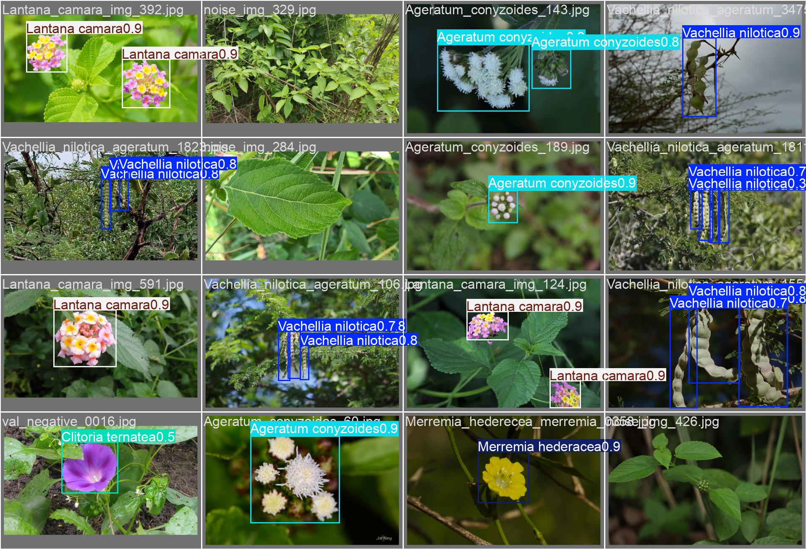
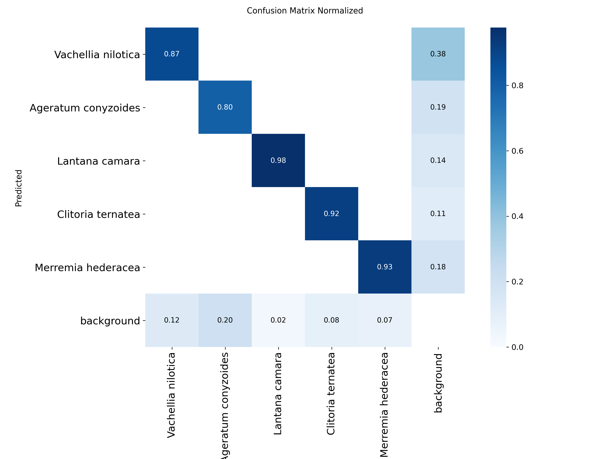
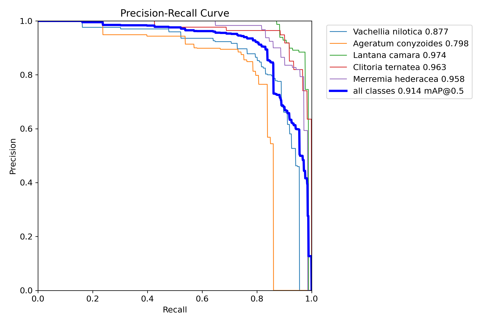
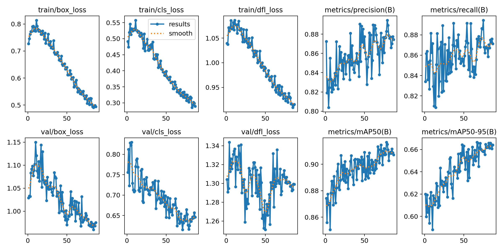
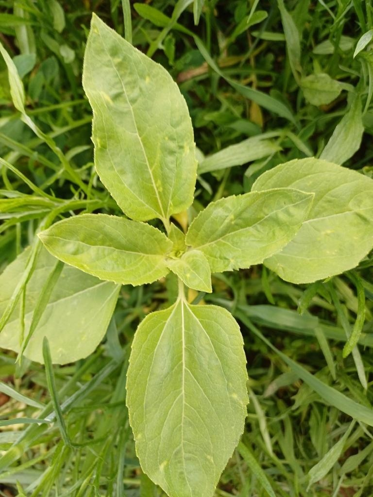
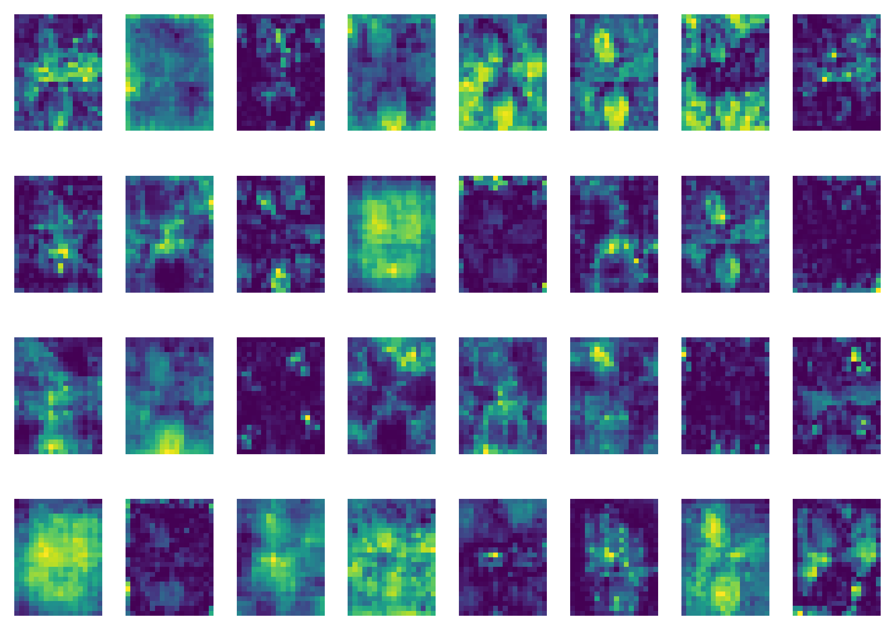

# Invasive Plant Species Detection with YOLO

Object detection model for **five invasive plant species common in tropical Indonesia**, built by the AI/ML team of a 2026 capstone project with BRIN (Badan Riset dan Inovasi Nasional). This repository covers the ML side: a hand-annotated dataset, 14 training experiments, the final model, and an explainability analysis. The application that serves the model lives in the team's deployment repository.

**Final model:** YOLO11s · **mAP50 0.915** · **mAP50-95 0.666** on a 296-image validation set



| ID | Species | Common name (EN / ID) |
|---|---|---|
| 0 | *Vachellia nilotica* | Gum arabic tree / Babul |
| 1 | *Ageratum conyzoides* | Billygoat-weed / Bandotan |
| 2 | *Lantana camara* | Lantana / Tembelekan |
| 3 | *Clitoria ternatea* | Asian pigeonwings / Bunga telang |
| 4 | *Merremia hederacea* | Ivy woodrose / Merremia |

---

## Dataset

📦 **[Invasive Plant Species Object Detection (YOLO), Kaggle](https://www.kaggle.com/datasets/miaikoo/invasive-plant-species-object-detection-yolo)**

Built from scratch for this project:

1. **Collection:** occurrence images downloaded from [GBIF](https://www.gbif.org/) (iNaturalist, Observation.org, and others) with [`src/download_gbif.py`](src/download_gbif.py).
2. **Annotation:** every bounding box was drawn by hand by the team, one species at a time, and exported in YOLO format.
3. **Merging and processing:** [`notebooks/01_dataset_processing.ipynb`](notebooks/01_dataset_processing.ipynb) merges the per-species annotation sets into one dataset. It validates image/label pairs, remaps per-species class IDs to the global mapping, adds **background images with empty labels** (hard negatives such as non-target leaves and flowers), and produces train/val/test splits.

| | Value |
|---|---|
| Images | 1,369 (+150 from a second version with extra negatives) |
| Background images | 156 |
| Bounding boxes | 586 / 404 / 407 / 266 / 375 (classes 0–4) |
| Final split used for training | 1,071 train · 296 val · 153 test |

Full dataset card and source citations: [`docs/dataset_card.md`](docs/dataset_card.md).

---

## Experiments

The ML team ran 14 experiments in parallel on Kaggle and Colab, logged in a shared sheet. The full log, including augmentation settings, is in [`experiments/experiments.csv`](experiments/experiments.csv).

| # | Who | Model | imgsz | Epochs | Notes | mAP50 | mAP50-95 |
|---|---|---|---|---|---|---|---|
| 1 | Mia | YOLO12n | 640 | 50 | baseline | 0.713 | 0.426 |
| 2 | Mia | YOLO12s | 800 | 50 | | 0.801 | 0.469 |
| 3 | Mia | YOLO12m | 1024 | 100 | batch 8 | 0.745 | 0.458 |
| 4 | Mia | YOLO12s | 800 | 100 | ROI cropping | 0.781 | 0.430 |
| 5 | Sultan | YOLOv8s | 640 | 100 | class order swapped, unreliable | (0.880) | (0.666) |
| 6 | Mia | YOLO11s | 640 | 100 | ROI cropping | 0.815 | 0.510 |
| 7 | Sultan | YOLOv8s | 640 | 100 | re-run of #5, results lost | – | – |
| 8 | Rachel | YOLOv8n | 640 | 50 | default augmentation | 0.889 | 0.683 |
| 9 | Efan | – | – | – | args not recorded † | 0.913 | 0.709 |
| 10 | Fina | YOLO12n | 800 | 60 | SGD, no mosaic | 0.885 | 0.656 |
| 11 | Rachel | YOLO11s | 832 | 120 | SGD, cosine LR, freeze 10 | 0.904 | 0.671 |
| 12 | Rachel | YOLOv8m | 640 | 50 | default augmentation | 0.897 | 0.669 |
| 13 | Efan | YOLO11s | 640 | 150 | Vachellia-focused aug † | 0.927 | 0.679 |
| 14 | Efan | – | – | 30 | offline Albumentations † | 0.907 | 0.683 |
| **Final** | Mia | **YOLO11s** | **768** | **87** | **fine-tuned from #9, AdamW** | **0.915** | **0.666** |

† Efan's runs used an exploratory version of the dataset, so their scores are not directly comparable with the rest.

### What we learned

- **Bigger was not better here.** YOLO12m at 1024 px (#3) scored lower than YOLO12s at 800 px (#2). With about 1k training images, the larger model plus the small batch size it needed did not pay off.
- **YOLO11 and YOLOv8 beat YOLO12 on this data.** The strongest runs (#8, #11, #12, #13) all used these architectures.
- **Heavy augmentation hurt.** Early runs with mosaic 0.4–0.5 and copy-paste plateaued around 0.47 mAP50-95. Runs with little or no mosaic (#10, #11, #13) reached 0.66 or higher.
- **ROI cropping did not help.** #4 matched or trailed the uncropped #2.
- **Transfer from a team checkpoint.** The final model starts from #9's weights and is fine-tuned on the full merged dataset with a low learning rate (AdamW, lr0 = 5e-4, cosine schedule) and light colour augmentation.

---

## Final model

Training notebook: [`notebooks/02_training_yolo11s_kaggle.ipynb`](notebooks/02_training_yolo11s_kaggle.ipynb) (Kaggle, Tesla T4). Early stopping at epoch 87, best checkpoint at epoch 67. Run artifacts: [`results/yolo11s_img768_adamw/`](results/yolo11s_img768_adamw/).

| Class | Instances | Precision | Recall | mAP50 | mAP50-95 |
|---|---|---|---|---|---|
| *Vachellia nilotica* | 136 | 0.833 | 0.816 | 0.882 | 0.544 |
| *Ageratum conyzoides* | 93 | 0.838 | 0.785 | 0.797 | 0.484 |
| *Lantana camara* | 86 | 0.891 | 0.950 | 0.974 | 0.845 |
| *Clitoria ternatea* | 61 | 0.901 | 0.918 | 0.964 | 0.778 |
| *Merremia hederacea* | 71 | 0.833 | 0.911 | 0.958 | 0.679 |
| **All** | **447** | **0.859** | **0.876** | **0.915** | **0.666** |

<p>
  
  
</p>



---

## Focus: *Vachellia nilotica*

Vachellia was the class we analysed most closely. It has the most instances in the dataset but the second-lowest mAP50-95.

- **The model recognises Vachellia by its seed pods.** In the validation predictions, almost every Vachellia box sits on the long, curved pods, not on the fine bipinnate foliage, which blends into cluttered backgrounds.
- **Localisation, not recognition, is the weak point.** mAP50 is reasonable (0.88) but mAP50-95 drops to 0.54. Pods are thin, elongated, and often overlapping, so small box offsets cost a lot of IoU at strict thresholds.
- **Hard negatives matter.** In one validation negative, a purple morning-glory flower is predicted as *Clitoria ternatea* with confidence 0.5. Visually similar non-target flowers are the main source of false positives, which is why background images were added to the dataset.

### Explainability (XAI)

Intermediate feature maps were extracted from all 23 stages of the network with Ultralytics `visualize=True`. The example below is a **background test image with no target species**: activations at the SPPF stage stay diffuse and no detection is produced, so the model does not fire on generic foliage.

<p>
  
  
</p>

All stages: [`results/yolo11s_img768_adamw/xai_feature_maps/`](results/yolo11s_img768_adamw/xai_feature_maps/).

---

## Deployment

A model from this work is served in the team's application, built by the backend, frontend, and DevOps members. The application code is in [capstone-if-26/CAPS12](https://github.com/capstone-if-26/CAPS12), which is private.

---

## Limitations and next steps

- *Ageratum conyzoides* is the weakest class (mAP50-95 0.48). Its small white flower clusters are easily missed or under-boxed.
- XAI covers feature-map visualisation on a single negative sample. Class-discriminative methods such as Grad-CAM or EigenCAM on Vachellia positives and failure cases would make the analysis stronger.
- Experiments were tracked manually in a spreadsheet. A tracker such as W&B or MLflow would have made the runs easier to compare and reproduce.

---

## Repository structure

```
├── configs/          dataset YAMLs (Kaggle paths)
├── notebooks/
│   ├── 01_dataset_processing.ipynb
│   └── 02_training_yolo11s_kaggle.ipynb
├── src/              GBIF image downloader
├── experiments/      experiment log (14 runs + final)
├── results/          training and evaluation artifacts of the final model
├── assets/           figures used in this README
└── docs/             dataset card and citations
```

The dataset (`data/`, ~6 GB) and model weights (`models/`) are not tracked in git. Get the dataset from Kaggle and the final weights (`best.pt`, ~18 MB) from this repository's **Releases** page.

```python
from ultralytics import YOLO

model = YOLO("best.pt")
model.predict("your_image.jpg", imgsz=768, conf=0.25, save=True)
```

---

## Team

AI/ML engineers: Efan, Fina, Mia, Rachel, Sultan.

| Work | By |
|---|---|
| Data collection and annotation | Whole team |
| Dataset merging and processing | Mia |
| Experiments | See the *Who* column in [Experiments](#experiments) |
| Final model and XAI | Mia, initialised from Efan's checkpoint |

Deployment by the backend, frontend, and DevOps team. See [CAPS12](https://github.com/capstone-if-26/CAPS12).

## Acknowledgements

Images come from the Global Biodiversity Information Facility (GBIF) and its data publishers, including iNaturalist, Observation.org, and Queensland WildNet. Source images remain under their original CC BY / CC BY-NC licences. See [`docs/dataset_card.md`](docs/dataset_card.md).
